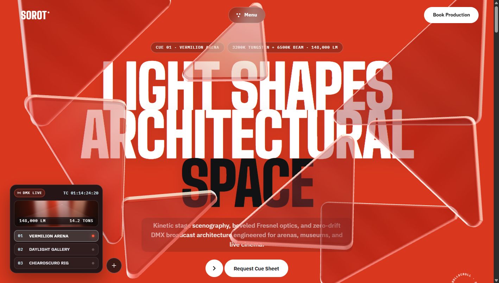
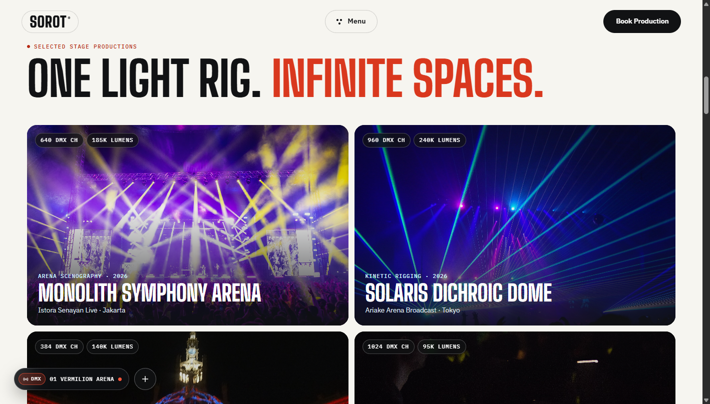
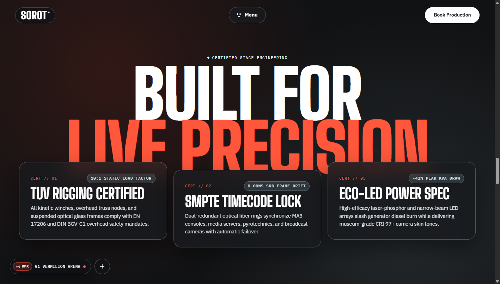

# SOROT · Kinetic Stage Scenography & Live Broadcast Studio

**Live Demo:** [https://sorot-scenics.vercel.app](https://sorot-scenics.vercel.app) · **Repository:** [github.com/MrEuwn/sorot-scenics](https://github.com/MrEuwn/sorot-scenics)

> **Project Status:** `Self-initiated` (Awwwards-grade chromatic drenched brand & WebGL optical glass portfolio showcase accompanying [Rumah Wiraloka](https://wiraloka-batik.vercel.app)).

SOROT is an architectural stage scenography and live broadcast lighting studio operating across Jakarta, Singapore, Tokyo, and Berlin, featuring a single shared Three.js WebGL2 Fresnel optical glass prism engine, interactive bottom-left DMX Live Lighting Cue Console, multi-chapter chromatic polarity transitions (`Signal Vermilion` <-> `Chalk Paper` <-> `Carbon Obsidian`), pauseable WCAG 2.2.2 ticker, and calibrated high-contrast glass surfaces.

## Visual Previews

| Signal Vermilion Hero & 3D Fresnel Prisms | Selected Stage Productions & DMX Telemetry |
| :---: | :---: |
|  |  |



## Architecture Highlights

- **Single Shared Three.js WebGL2 Fresnel Prism Engine (`src/components/FresnelStageCanvas.jsx`)**: Custom GLSL beveled optical glass shader rendering sculpted right-triangular Fresnel louvers in the hero stage and cantilevered horizontal glass louver beams in the closing monolith footer.
- **Interactive Bottom-Left Live Lighting Cue Console (`src/components/LiveCueWidget.jsx`)**: Real-time DMX timecode monitor with 3 mechanical cue switches (`01 VERMILION ARENA`, `02 DAYLIGHT GALLERY`, `03 CHIAROSCURO RIG`) that dynamically mutate live WebGL shader optics, stage beam lighting, and hero atmosphere polarity, paired with a technical specification drawer.
- **Multi-Chapter Chromatic Polarity Shifts**: Seamless transitions across Signal Vermilion (`#D9381E`), Chalk Paper (`#F6F5F0`), Carbon Obsidian (`#111214`), and Optical Ice (`#CFF4FF`) with IntersectionObserver adaptive header backing.
- **Accessibility & Performance Craft**: Instant LCP with zero blocking preloaders, zero hidden iframes, explicit `Pause / Play` ticker controls (WCAG 2.2.2), full `prefers-reduced-motion` compliance, explicit `IBM Plex Sans` button font inheritance, and WCAG AA/AAA calibrated contrast across glass surfaces.

## Local Development

```bash
npm install
npm run dev
```

Runs on `http://localhost:5184`.

## Production Build

```bash
npm run build
npm run preview
```
